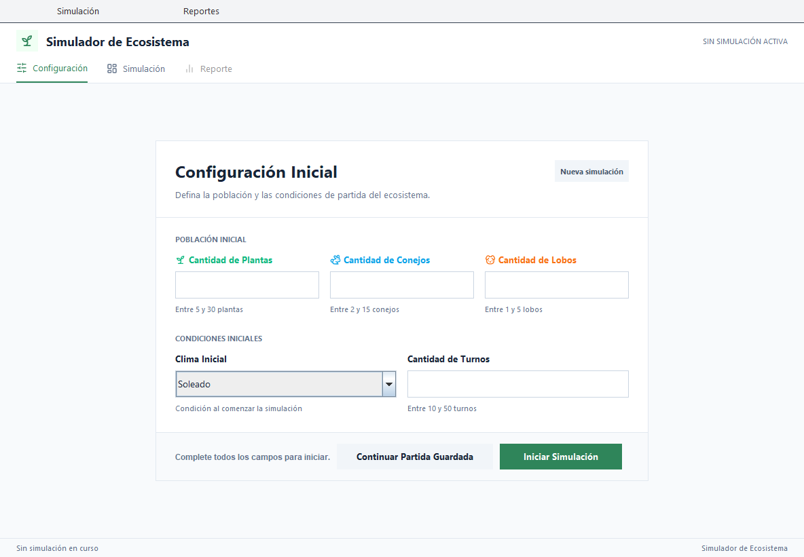
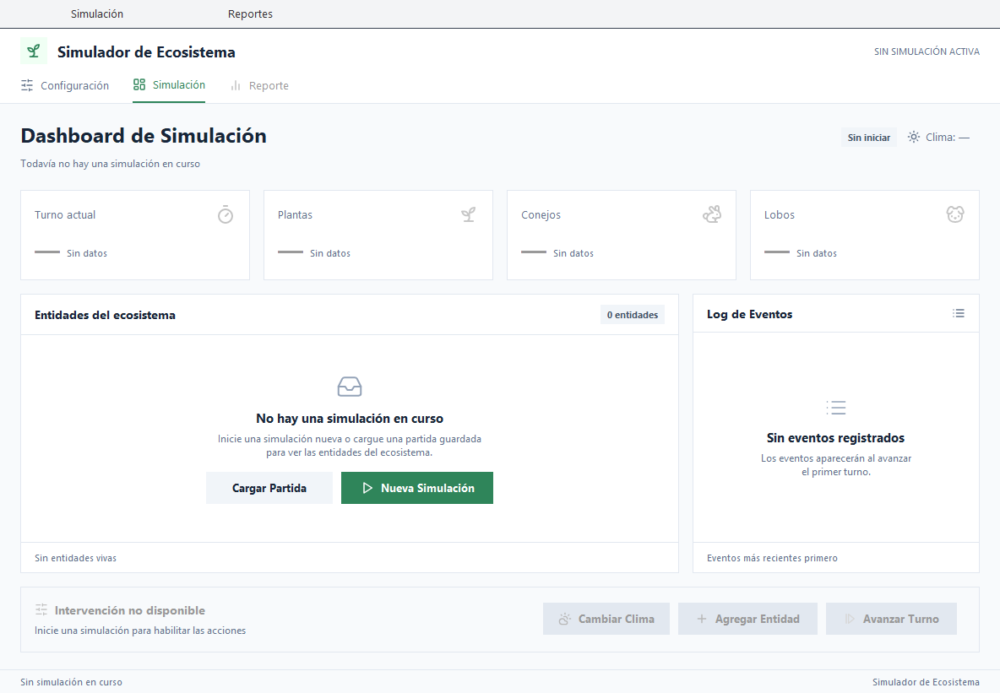
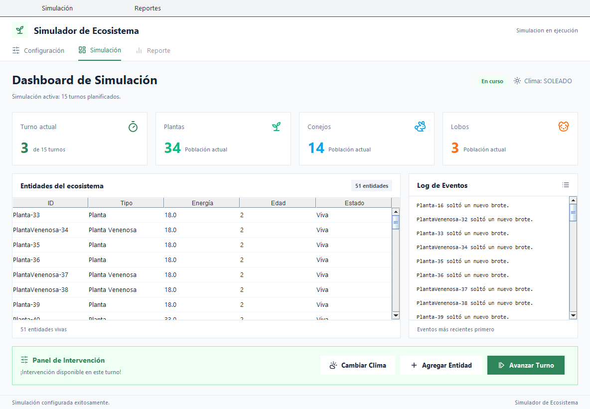
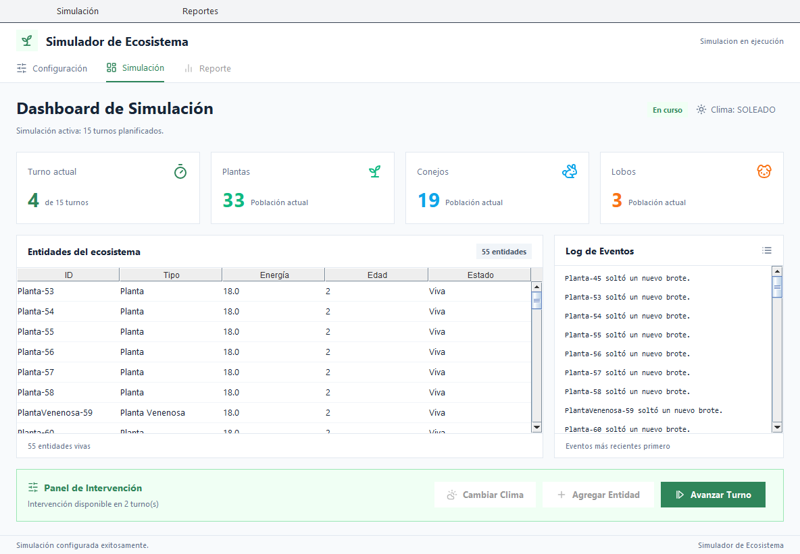
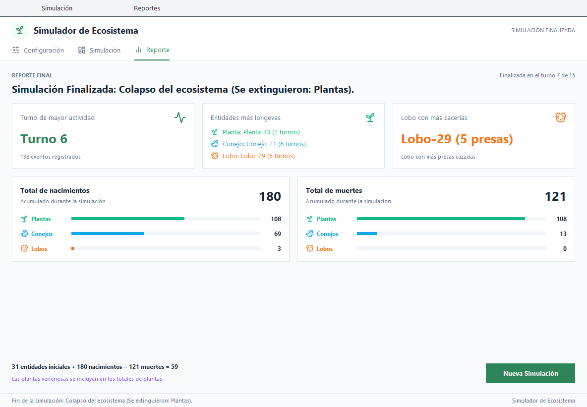

# Simulador de Ecosistema
Segunda instancia evaluativa de Interfaz Gráfica: interfaz gráfica en Swing con arquitectura MVC y persistencia en archivo.

# Diseño en Figma
Prototipo navegable: https://www.figma.com/design/69ctljJLhkF0rvbL7fl4dS/2IE-InterfazGrafica

Para recorrerlo, abrir el archivo y presionar **Present**. El flujo "Flujo principal" arranca en la pantalla "Sin simulación en curso".

# Instrucciones de ejecución
1. Clonar el repositorio y abrir la carpeta `SimuladorEcosistema` como proyecto en NetBeans.
2. Hacer **Clean and Build**.
3. Ejecutar el proyecto (**Run Project**). La clase principal es `principal.Main`.
4. En **Configuración** cargar la población inicial y presionar **Iniciar Simulación**. Ejemplo:
   - Plantas: 20
   - Conejos: 8
   - Lobos: 3
   - Clima inicial: Soleado
   - Turnos: 15
5. En **Simulación** presionar **Avanzar Turno**. Cada 3 turnos se habilita el Panel de Intervención para cambiar el clima o agregar una entidad.
6. Al terminar la simulación se habilita la pestaña **Reporte** con el resumen final.
7. Desde el menú **Simulación** se puede guardar la partida (`partida_simulacion.txt`) y cargarla más tarde.

# Estructura del proyecto
```
Parcial1-InterfazGr-fica/
├── README.md
├── docs/capturas/                     (capturas de la aplicación)
└── SimuladorEcosistema/
    ├── build.xml
    ├── manifest.mf
    ├── nbproject/
    └── src/
        ├── principal/
        │   └── Main.java
        ├── modelo/
        │   ├── Entidad.java, Mortal.java, Reproducible.java, Clima.java
        │   ├── Planta.java, PlantaVenenosa.java, Animal.java, Conejo.java
        │   ├── Lobo.java, Peligroso.java
        │   └── Ecosistema.java
        ├── vista/
        │   ├── VentanaPrincipal.java/.form
        │   ├── PanelConfiguracion.java/.form
        │   ├── PanelSimulacion.java/.form
        │   └── PanelReporte.java/.form
        ├── controlador/
        │   └── ControladorPrincipal.java
        ├── dao/
        │   └── SimulacionDAO.java
        └── recursos/iconos/           (iconos PNG usados por la vista)
```

# Integrantes y roles (segunda instancia)
- **Hedda Conci:** diseño en Figma y prototipo navegable, VentanaPrincipal (menú, cabecera, pestañas y barra de estado), PanelConfiguracion, ajuste visual de PanelSimulacion y PanelReporte al diseño, iconos.
- **Yazmin Riquelme:** PanelSimulacion y PanelReporte.
- **Ismael Gorocito:** SimulacionDAO e integración del ControladorPrincipal con Main.
- **Martino Recio:** ControladorPrincipal, limpieza del modelo y estadísticas del reporte.

# Escenario de uso
**Persona:** Lucía, 21 años, estudiante de Biología. Tiene que mostrar en clase cómo el clima y la cantidad de depredadores afectan a una población. No sabe programar y usa la computadora para estudiar y hacer trabajos prácticos.

**Escenario:** Lucía abre el simulador y ve que no hay ninguna simulación en curso. Desde Configuración carga 20 plantas, 8 conejos y 3 lobos con clima soleado y 15 turnos. Avanza turno a turno mirando cómo cambian los contadores y el log de eventos. En el turno 3 cambia el clima a sequía para ver qué pasa con las plantas. Como la clase termina, guarda la partida y al otro día la carga para terminarla. Al final revisa el reporte y usa los totales de nacimientos y muertes en su presentación.

# Decisiones de diseño
1. **Pestañas siempre visibles y estado vacío en lugar de pantallas ocultas.** La ventana muestra siempre Configuración, Simulación y Reporte. Cuando todavía no hay simulación, el dashboard explica qué falta y ofrece "Nueva Simulación" y "Cargar Partida", en vez de mostrar tablas vacías. Así el usuario siempre sabe dónde está y qué puede hacer.
2. **Las acciones no disponibles se ven deshabilitadas en vez de desaparecer.** Los botones de intervención y la pestaña Reporte se muestran grises hasta que se pueden usar, con un texto que dice cuándo se habilitan ("Intervención disponible en 2 turnos"). El usuario aprende la regla de los 3 turnos sin leer instrucciones y la interfaz no cambia de forma entre turnos.
3. **Un color por especie y un solo color de acción.** Verde para plantas, celeste para conejos y naranja para lobos, repetidos en los contadores, las etiquetas del formulario y el reporte, para reconocer cada especie de un vistazo. El verde oscuro se reserva para la acción principal de cada pantalla (Iniciar Simulación, Avanzar Turno, Nueva Simulación), así queda claro cuál es el siguiente paso.

# Capturas
| Configuración | Sin simulación en curso |
|---|---|
|  |  |

| Simulación con intervención disponible | Simulación con intervención bloqueada |
|---|---|
|  |  |

| Reporte final |
|---|
|  |

# Documentación de uso de IA (segunda instancia)
- *[Hedda Conci]*
Conversación completa: https://share.gemini.google/pEtCKnLqowN9

- *[Yazmin Riquelme]*

- *[Ismael Gorocito]*
Conversación completa: https://chatgpt.com/share/6ab9ccef-46c0-83e9-9234-a2eae3a146de?ogimg=plain

- *[Martino Recio]*

# Link del video (segunda instancia)

# Primera instancia evaluativa

## Integrantes y roles
- **Yazmin Riquelme:** Base del sistema.
- **Hedda Conci:** Plantas y conejos.
- **Ismael Gorocito:** Lobos y ecosistema (implementacion de las clases lobo, ecosistema e interfaz peligroso-).
- **Martino Recio:** Main y reporte final (Loop interactivo, menú de configuración, intervenciones y reporte final).

## Desafios encontrados
- **Yazmin Riquelme: Consultar la energía desde una interfaz:** en Mortal, verificarMuerte() necesitaba saber la energía de la entidad, pero una interfaz no tiene atributos. Lo resolví declarando getEnergia() como método abstracto en la interfaz Conejo y Lobo ya lo heredan de Entidad, así que no tienen que escribirlo de nuevo.
- **Dependencia con Ecosistema:** Entidad recibe un Ecosistema en actuar(), pero esa clase la desarrollaba otro integrante. Dejé una clase Ecosistema vacía para poder compilar en paralelo hasta que llegue la versión completa.
  
- **Hedda Conci:** El mayor desafío arquitectónico fue la dependencia de código: mis clases (Conejo, Planta) necesitaban interactuar con las listas de la clase Ecosistema, la cual estaba siendo desarrollada en paralelo por otro compañero y aún no estaba finalizada. Lo resolví apoyándome en el control de versiones, trabajando en mi propia rama aislada en Git. Programé la lógica interna de los seres vivos y dejé temporalmente comentadas las llamadas externas a las listas para poder compilar y testear de forma independiente. Una vez que la clase Ecosistema se integró a la rama principal (main), fusioné mi código y descomenté las líneas, logrando una integración limpia.
  
- **Ismael Gorocito:** El mayor desafío fue desarrollar la clase central Ecosistema en paralelo con la lógica de depredación (Lobo y la jerarquía de entidades Peligroso). Como mis compañeros dependían de las listas del ecosistema para programar sus seres vivos, subí primero una estructura base a Git para no bloquear su trabajo. A nivel de código, el reto principal fue lograr que los lobos cazaran y eliminaran conejos sin generar errores de concurrencia al modificar las listas mientras el sistema las estaba recorriendo en cada turno. Lo resolví usando iteradores seguros (o listas de bajas temporales) para separar la búsqueda de presas de su eliminación, logrando una simulación estable.

- **Martino Recio:** Uno de los principales problemas que tuve fue organizar bien el funcionamiento del programa y hacer que todo se coordinara correctamente con los turnos y las distintas entidades. Como estaba trabajando principalmente con la clase SimuladorEcosistema, tenía que encargarme de la entrada de datos, de avanzar los turnos y de mostrar el menú de intervención cada tres turnos. Para hacer esto dependía también de cómo estaban implementadas las clases Ecosistema, Conejo y Lobo por parte de mis compañeros.

Cuando empezamos a probar todo junto, vimos que había un problema con el equilibrio de la simulación, ya que las plantas se terminaban muy rápido, generalmente en el turno 1 o 2. Esto hacía que no pudiéramos llegar al turno 3 para probar el menú de intervención. Revisando el funcionamiento, encontramos que no se estaban generando nuevos brotes cuando las plantas se reproducían y que también había una llamada que se hacía de más al momento de comprobar si las presas habían muerto.

## Documentación de uso de IA
- *[Yazmin Riquelme]*
Conversación completa: https://claude.ai/share/128e321c-f3fc-41aa-87e3-907464d06666

- *[Hedda Conci]*
Conversación completa: https://share.gemini.google/13LGl97w3Vyk

- *[Ismael Gorocito]*
Conversación completa: https://chatgpt.com/share/6ab9ccef-46c0-83e9-9234-a2eae3a146de?ogimg=plain

- *[Martino Recio]*
Conversación completa: https://share.gemini.google/j66ctnUDSd1P

## Link del video
https://drive.google.com/file/d/1XqtY-RKrW1qgPAI8oHoBMj8hoPCnkeIK/view?usp=drivesdk
